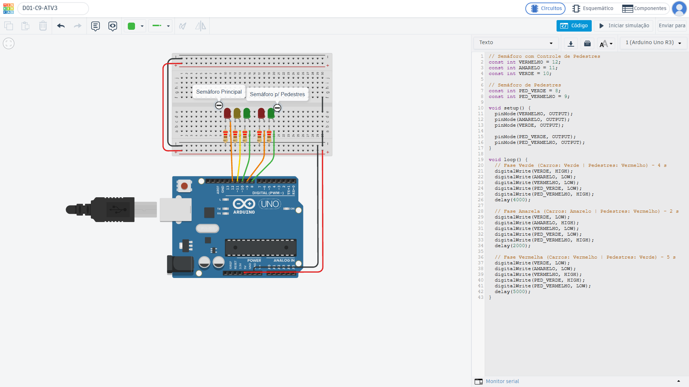

# Projeto Semáforo de Trânsito e Pedestres com Arduino (semaforo-arduino: D01-C9-ATV3)

Este projeto consiste na simulação e programação de um sistema de semáforo duplo (veículos e pedestres) utilizando a plataforma Arduino. O sistema simula o controle de fluxo de trânsito urbano com temporização definida para cada fase, garantindo a travessia segura de pedestres.

## 🔗 Circuito no Tinkercad
- **Link do projeto:** [Acesse a simulação do circuito no Tinkercad](https://www.tinkercad.com/things/9Sak11OUcIM-d01-c9-atv3?sharecode=HzsKGI2Jiir-lqL6oCw6eQCXeERM8Log4dd08ttIFwI)

## 📸 Captura do Circuito

## 🧰 Componentes Utilizados
- 1x Placa Arduino Uno R3
- 1x Protoboard
- 3x LEDs para veículos (Vermelho, Amarelo, Verde)
- 2x LEDs para pedestres (Vermelho, Verde)
- 5x Resistores de 220 Ω
- Jumper Wires

## ⏱️ Ciclo de Funcionamento
| Fase | Semáforo Veículos | Semáforo Pedestres | Duração |
| :--- | :--- | :--- | :--- |
| **1. Verde** | Verde (LIGADO) | Vermelho (LIGADO) | 4 segundos |
| **2. Amarelo** | Amarelo (LIGADO) | Vermelho (LIGADO) | 2 segundos |
| **3. Vermelho** | Vermelho (LIGADO) | Verde (LIGADO) | 5 segundos |

---

## Uso na escola

**Ano/Série:** 1º anos do Ensino Médio Técnico  
**Componentes Curriculares:** Ciências (Física/Eletricidade), Matemática e Geografia (Educação para o Trânsito e Mobilidade Urbana).

### Problema do Cotidiano Escolar
A segurança no trânsito no entorno da escola nos horários de entrada e saída é um desafio constante. O grande fluxo de veículos aliado à pressa dos pedestres (alunos e responsáveis) gera situações de risco no momento da travessia da rua em frente ao portão principal.

### Condução do Desafio com os Estudantes
A atividade será conduzida através da Aprendizagem Baseada em Problemas (PBL). Inicialmente, os alunos realizarão a observação do trânsito na frente da escola, registrando os tempos de espera e o comportamento dos motoristas e pedestres. Em seguida, no laboratório de informática ou espaço Maker, os estudantes serão desafiados a propor uma solução automatizada utilizando o Arduino. 

Em duplas ou trios, eles montarão o circuito físico (ou na plataforma Tinkercad) e programarão a sequência dos LEDs. A mediação do professor focará no ajuste lógico do código e na discussão sobre a importância de calcular tempos suficientes para que uma criança ou pessoa com mobilidade reduzida consiga atravessar a rua em segurança.

### Aprendizagens Esperadas
- **Ciências:** Compreensão prática de circuitos elétricos em série e paralelo, função dos resistores (limitação de corrente) e polaridade de componentes como o LED.
- **Matemática:** Razão, proporção e lógica de programação aplicada à contagem de tempo (milissegundos) e ciclos temporais.
- **Geografia e Cidadania:** Conscientização sobre mobilidade urbana, segurança viária, respeito às sinalizações e cidadania ativa no espaço escolar.
- **Tecnologia:** Introdução à lógica de programação (funções, variáveis e estruturas de controle) e prototipagem eletrônica com Arduino.
